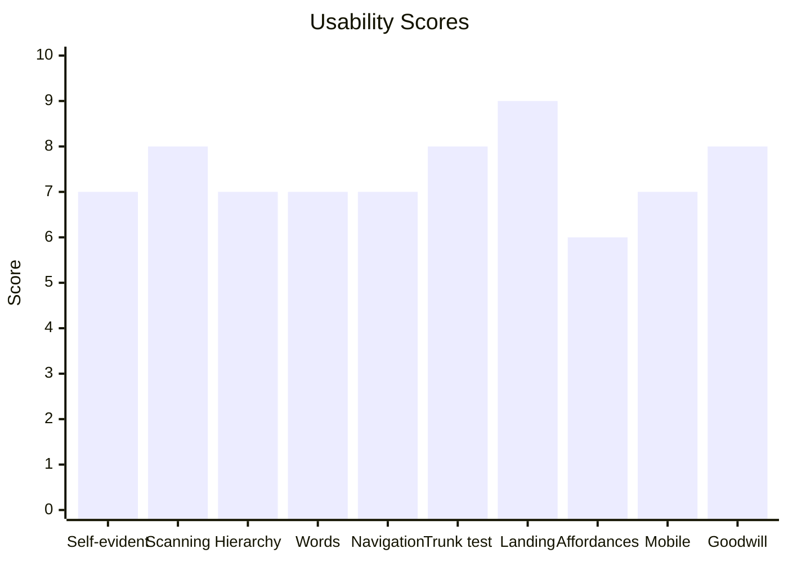
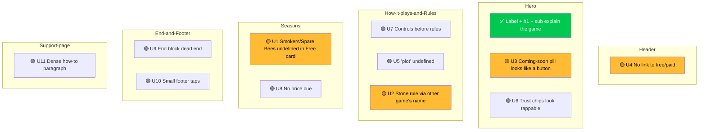
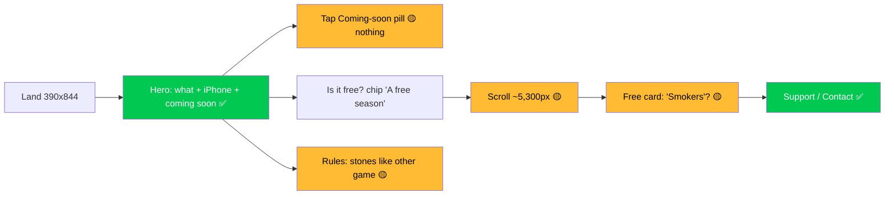

# Usability Review: Skepfield landing site (index, support, privacy, 404)

> Orchestrated by: design-optimizer

**Result:** COMPLETE — 11 issues (0 🔴 · 4 🟡 · 7 🟢); 10 of 10 applicable lenses scored

## Thinking Cost: MODERATE

> The page explains the game well in 5 seconds, but the "Coming soon" pill looks like the main button and does nothing, and the free/paid answer sits far down the mobile page behind tool names ("Smokers", "Spare Bees") that are used before they are explained.

Tags: **surgical** = copy, labels, link targets, aria, small markup; look unchanged. **owner-proposal** = changes the approved look or layout; owner decides.

## Scorecard

| Lens | Score | Why |
|---|---|---|
| Self-evidence | 7/10 | Rules are plain; "plot", "Smokers", "Spare Bees" and the stone count lean on undefined terms or another game's name |
| Scanning | 8/10 | Label + h2 per section, short cards; support "How to play" is one 7-sentence paragraph |
| Visual hierarchy | 7/10 | h1 and rules cards are strong; the non-clickable `.soon` pill carries the most visual weight above the fold |
| Word economy | 7/10 | Mostly tight; "Starter tools" line is 38 words, Almanac explained twice |
| Navigation | 7/10 | Header: Rules, Support only; no shortcut to the free/paid section (`#seasons`) |
| Trunk test | 8/10 | Every page shows brand + h1; support/privacy/404 link home via brand and footer |
| Landing clarity | 9/10 | Label "Beehive logic puzzle for iPhone" + h1 + sub + "Coming soon" + chips answer what/where/when at 390x844 |
| Affordances | 6/10 | Two `.soon` pills and four `.trust` chips are pill-shaped with shadows like buttons, but are static text |
| Mobile | 7/10 | Single column, no horizontal scroll; free/paid lands far down (~70% of a ~7,600 px page, estimate); footer links small |
| Goodwill | 8/10 | Free vs paid stated honestly, no ads/tracking, support email visible; no price yet (unavoidable pre-launch) |

## Issues

### 🟡 U1 Tool names used before they are explained — surgical
- **Problem:** Free card says "3 Smokers and 2 Spare Bees" with no meaning; the definition only appears later in the "Buy once" card.
- **Impact:** Visitor reading "what is free" stops to guess what a Smoker is; the 38-word line also buries the earn rule.
- **Fix:** Replace the item text with: `<b>Starter tools</b>3 Smokers (each places one right hive) and 2 Spare Bees (each calls a lost bee back). Clearing every tenth field of a season, or every daily field in a week, earns more, up to 9 of each.`; in the Kit item shorten to `10 Smokers and 5 Spare Bees, buy as often as you need.`
- **Where:** index.html:265 (`.offer .card:first-child .items li:last-child`), index.html:275

### 🟡 U2 Stone rule explained only by comparison to another game — surgical
- **Problem:** The only explanation of how a stone counts is "like the numbers in [another game]"; visitors who do not know that game get no rule, and rule 4 says "touch" without saying which cells.
- **Impact:** Yes, a clarity issue: the analogy relies on outside knowledge, the key fact (eight cells around, corners included) is never stated on the page, and it contradicts the store listing, which deliberately names no other game.
- **Fix:** Replace the line with: `
A stone holds no hive. Its number counts the hives in the eight cells around it, corners included, and settles questions the other rules leave open.
` (facts from listing-en-US.md: "Grey field stones hold no hive; the number on a stone tells how many hives stand in the eight cells around it.")
- **Where:** index.html:249 (`#rules .controls`)

### 🟡 U3 "Coming soon" pill looks like the primary button but does nothing — owner-proposal
- **Problem:** `.soon` is a wax-yellow pill with a straw ring, drop shadow and icon: the strongest button-shaped element on the page, but it is a `
`.
- **Impact:** Visitors tap it expecting the App Store; nothing happens (twice: hero and end block).
- **Fix:** Owner-proposal: keep the wax colour and text but drop the button cues (`box-shadow` ring and lift) so it reads as a status badge, e.g. `.soon { box-shadow: none; border: 2px dashed var(--straw); }`. No surgical fix changes the perception without touching the look; the text "Coming soon to the App Store" stays.
- **Where:** index.html:106-110 (`.soon` CSS), index.html:211 (hero), index.html:303 (`.end .soon`); mobile-fold.png pill at y≈380-435

### 🟡 U4 No shortcut to "what is free vs paid" — surgical
- **Problem:** Header nav has only "Rules" and "Support"; the Seasons section (free vs buy once) is ~5,300 px down the 390 px page (estimate from mobile.png).
- **Impact:** A visitor asking "is it free?" sees the chip "A free season" but must scroll past two sections to learn what is paid.
- **Fix:** Add one link under the trust chips: `
<a href="#seasons">What's free and what's paid</a>
` after index.html:214. (A third header nav item "Seasons" would likely wrap next to the brand at 390 px: not recommended.)
- **Where:** index.html:202 (`.top nav`), index.html:212-214 (`.trust`); mobile.png

### 🟢 U5 "Plot" is never defined — surgical
- **Problem:** Hero and rule 1 say "plot" without saying a plot is one coloured patch of the field.
- **Impact:** Cold visitors pause on rule 1, the core rule.
- **Fix:** Rule 1: `
Every plot (one coloured patch of the field) gets exactly one hive.
`
- **Where:** index.html:244 (`.rules li:first-child p`); also index.html:210

### 🟢 U6 Trust chips look like tappable filter chips — owner-proposal
- **Problem:** `.trust li` are white pills with `--lift` shadow, the same treatment as buttons.
- **Impact:** Minor: some taps on "A free season" expecting details.
- **Fix:** Owner-proposal: drop the shadow (`.trust li { box-shadow: none; border: 1px solid var(--line); }`). Surgical alternative: U4's link right below them answers the tap intent.
- **Where:** index.html:113, index.html:212-214

### 🟢 U7 Controls and bees come before the rules — owner-proposal
- **Problem:** "How it plays" (tap/cross, three bees, Almanac) precedes "The rules", so mechanics arrive before the goal.
- **Impact:** Slight backtracking; the hero sub already gives the gist, so low cost.
- **Fix:** Owner-proposal: swap `#rules` above `#plays` (layout order change).
- **Where:** index.html:221-251

### 🟢 U8 Buy-once card gives no price cue — surgical (owner confirms wording)
- **Problem:** "Buy once" lists four items with no price; prices cannot be shown before release.
- **Impact:** Visitors wonder "how much?"; no answer anywhere.
- **Fix:** Append to `.note`: "Prices will show in the App Store at launch." (owner confirms; no price added).
- **Where:** index.html:277 (`.offer .note`)

### 🟢 U9 End block is a dead end — surgical
- **Problem:** The closing block repeats brand + a second non-clickable "Coming soon" pill; no next step.
- **Impact:** Visitors who scrolled to the end have nothing to do but leave.
- **Fix:** Add after index.html:303: `
<a href="support.html">Questions before launch? Visit support</a>
`
- **Where:** index.html:299-304 (`.end`)

### 🟢 U10 Footer links are small tap targets on mobile — surgical
- **Problem:** `footer nav a` have no padding: ~27 px tall at 17px/1.6 (estimate from CSS).
- **Impact:** Mis-taps between Privacy / Support / Contact on phones.
- **Fix:** `footer nav a { padding: 8px 0; }` (vertical only; spacing barely changes).
- **Where:** index.html:181; same pattern support.html:57, privacy.html footer

### 🟢 U11 Support "How to play" is one dense paragraph — surgical
- **Problem:** Controls, bees, Almanac, Smoker and Spare Bee are packed into one 7-sentence paragraph.
- **Impact:** A player looking for one answer (e.g. "what does a Smoker do?") must read it all.
- **Fix:** Split into a `<ul>`: "Tap a cell to cross it out; tap a cross to place a hive; drag to cross out a run." / "Undo takes back crosses, not hives." / "Each field starts with 3 bees; a wrong hive sends one away. With none left, start the field again." / "The Almanac explains the next step, 3 pages a day." / "A Smoker places one right hive; a Spare Bee calls a lost bee back." / "The full rules are behind the "?" button in the game."
- **Where:** support.html:78; support-390.png y≈630-870

## Issue Map

## Page Flow Analysis

## What Works

- ✅ Above the fold at 390x844: category label, h1, one-line rules sub, "Coming soon to the App Store", four trust chips
- ✅ Rules as four numbered cards with the twist highlighted (`.rule.twist`)
- ✅ Free vs "Buy once" split into two labelled cards with "No subscription" and restore path
- ✅ Real game screenshots with descriptive alt text
- ✅ Support page: email first, what to include, purchases and progress answered plainly
- ✅ 404 "No hive here" gives three clear ways back

## Fix Priority

| Priority | Issue | Effort | Impact |
|---|---|---|---|
| 1 | U2 Stone rule self-contained copy (surgical) | Low | High |
| 2 | U1 Define Smokers/Spare Bees in Free card (surgical) | Low | High |
| 3 | U4 "What's free and what's paid" link (surgical) | Low | Medium |
| 4 | U3 Coming-soon pill reads as button (owner-proposal) | Low | Medium |
| 5 | U5 Define "plot" in rule 1 (surgical) | Low | Low |
| 6 | U9 Support link in end block (surgical) | Low | Low |
| 7 | U10 Footer tap padding (surgical) | Low | Low |
| 8 | U11 Support how-to as list (surgical) | Low | Low |
| 9 | U8 Price cue line (surgical, owner confirms) | Low | Low |
| 10 | U6 Trust chips flatter (owner-proposal) | Low | Low |
| 11 | U7 Swap rules above how-it-plays (owner-proposal) | Medium | Low |

## Evidence and Limits

- **Reviewed:** evidence-dir page.html (= index.html), screenshots/desktop.png (1440 wide), mobile.png (390 wide), mobile-fold.png (390x844); source support.html, privacy.html, 404.html; own capture support-390.png (390x1400, this dir); facts cross-checked against skepfield/store/listing-en-US.md
- **Measured:** none — visual inspection only (`process_screenshots.py` not run); all pixel positions and heights are estimates
- **Not assessed:** none
- **Not tested:** clicks, hover, focus order, anchor jumps (`#rules`), mailto handling, 404 on live host, privacy page at 390 (code read only)
- **Assumptions:** Assumption: a third header nav item wraps at 390 px (estimated from CSS widths). Assumption: U8 wording needs owner confirmation since prices are not in the source facts.

## Next Decision

Apply the surgical fixes (U1, U2, U4, U5, U9, U10, U11, U8 after owner confirms wording) via Redesign Mode with a dry-run diff first, and take U3, U6, U7 to the owner as look-changing proposals.
